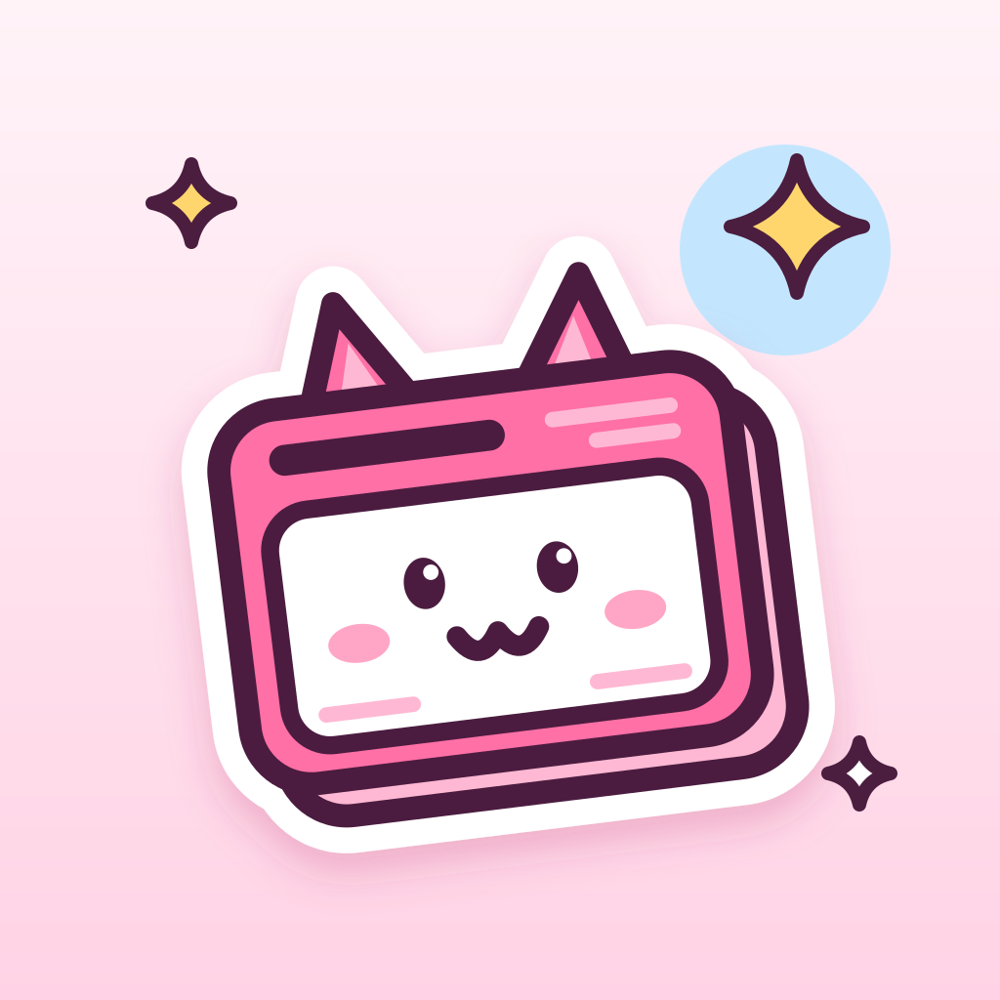

# UwUNews



Der RSS- und Atom-Reader der UwUSuite. Quellen sammeln, zu Sammlungen und
Filter-Feeds bündeln und eine Mitteilung bekommen, wenn etwas Neues erscheint,
pro Quelle und pro Sammlung an- oder abschaltbar. Quellen, Sammlungen und was
gelesen oder gemerkt ist, lassen sich Ende-zu-Ende-verschlüsselt über einen
UwUSync- oder UwULock-Server abgleichen.

Zuerst für iOS 26 (SwiftUI, Liquid Glass); der Kern ist Rust und kommt später
auch in eine Windows-App.

| Wo | Was |
|---|---|
| [`docs/plan.md`](docs/plan.md) | Plan, Datenmodell, Meilensteine |
| `crates/uwunews-feed` | Abrufen, RSS/Atom/JSON Feed parsen, Filterregeln, OPML, Feed-Erkennung |
| `crates/uwunews-proto`, `-vault`, `-store`, `-sync` | Sync-Format, Verschlüsselung, SQLite, UwUSync/UwULock |
| `crates/uwunews-ffi` | die `Engine` für Swift (UniFFI) |
| `bindings/swift` | Swift-Paket `UwUNewsCore` um das XCFramework |
| `ios/` | die App (XcodeGen) |

## Prüfen

```sh
cargo fmt --all --check
cargo clippy --workspace --all-targets --locked -- -D warnings
cargo test --workspace --locked
```

## iOS bauen

Braucht Xcode 27, Rust mit den iOS-Targets und XcodeGen.

```sh
scripts/build-apple.sh          # Rust-Kern als XCFramework + Swift-Bindings
cd ios && xcodegen generate     # UwUNews.xcodeproj
open UwUNews.xcodeproj
```

Das eigene Team und eine eigene Bundle-ID gehören in
`ios/Config/UwUNews.local.xcconfig` (nicht eingecheckt):

```
DEVELOPMENT_TEAM = ABCDE12345
UWUNEWS_BUNDLE_ID = com.example.uwunews
```

Die Nyu-Sticker und das Icon zeichnet `scripts/art.py` neu.

## Lizenz

GPL-3.0-or-later. Die Schrift UwU Sans steht unter der SIL Open Font License
(`ios/UwUNews/Resources/Fonts/OFL.txt`).
